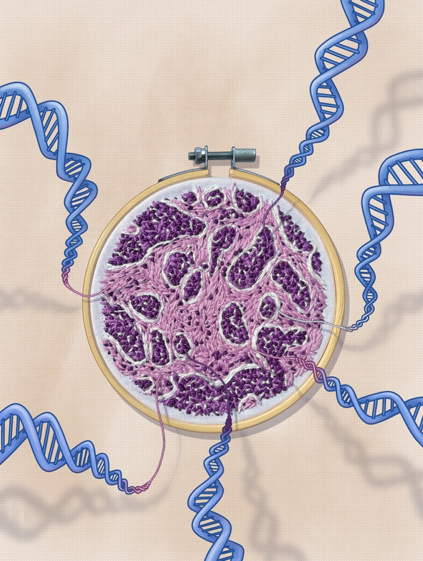
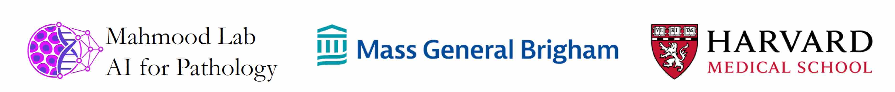

# THREADS 🧵

## A multimodal foundation model for molecular and morphologic data in oncology
*Nature Cancer* (2026)

[Journal link](https://doi.org/10.1038/s43018-026-01252-w) | [Download model](https://huggingface.co/MahmoodLab/threads) | [Benchmark (Patho-Bench)](https://github.com/mahmoodlab/Patho-Bench) | [Cite](#reference)

Anurag Vaidya\*, Andrew Zhang\*, Guillaume Jaume\*, Andrew H. Song, Tong Ding, Sophia J. Wagner, Ming Y. Lu, Harry Robertson, Drew F. K. Williamson, Paul Doucet, Cristina Almagro-Pérez, Richard J. Chen, Dina ElHarouni, Georges Ayoub, Connor Bossi, Keith L. Ligon, Ellis Patrick, Himisha Beltran, Laura MacConaill, Neal Lindeman, Lynette Sholl, Georg K. Gerber, Long Phi Le†, Faisal Mahmood†

\* Equal contribution. † Jointly supervised this work.



**Abstract:** Foundation models are advancing computational pathology by transferring knowledge from large datasets to diagnostic, prognostic and treatment response tasks. Most existing models, however, either operate at the patch level or learn slide-level representations using image-based objectives, coarse tissue labels or pathology reports that vary across institutions and reflect the subjectivity inherent in narrative reporting. Here, we introduce **THREADS**, which instead learns general-purpose whole-slide representations by aligning tissue morphology with genomic or transcriptomic profiles. THREADS was pretrained on over 47,000 hematoxylin-and-eosin-stained tissue sections and evaluated across 107 oncology tasks spanning cancer subtyping and grading, tumor microenvironment characterization, treatment response prediction and survival analysis. THREADS consistently outperformed leading whole-slide foundation models and supervised baselines while demonstrating strong transfer across external cohorts and high label efficiency. These findings establish molecularly guided pretraining as an effective strategy for learning general-purpose whole-slide representations and motivate future extensions incorporating additional molecular, spatial and clinical modalities.

<br clear="right"/>

## What is THREADS?
**THREADS** is a slide encoder for hematoxylin and eosin (H&E) whole-slide images (WSIs). It takes the [CONCH v1.5](https://huggingface.co/MahmoodLab/conchv1_5) patch embeddings of a slide and returns one 1,024-dimensional slide embedding.

THREADS was pretrained on MBTG-47K: 47,171 H&E WSIs from 39 organs, collected at Mass General Hospital, Dana-Farber Cancer Institute/Brigham and Women's Hospital, GTEx and TCGA. Each slide is paired with the molecular profile of the same tissue: bulk RNA sequencing (26,615 slides) or DNA variants and copy-number changes from a targeted gene panel (20,556 slides). During pretraining, contrastive learning pulls each slide embedding towards the embedding of its own molecular profile.

- _**Why use THREADS?**_ The slide embedding carries morphology that is linked to gene expression and mutation. A linear model on frozen THREADS embeddings, trained with a fixed cost and no tuning, ranked first on 75 of 107 tasks against PRISM, GigaPath and CHIEF, and the gains were largest in small treatment-response cohorts (see [Comparisons and benchmarks](#comparisons-and-benchmarks) for how the evaluation was run). The same embeddings support case retrieval and *molecular prompting*, where a slide is classified by its nearest average molecular profile.
- _**What is in this repository?**_ `threadsmodel` loads the pretrained THREADS slide encoder and turns patch embeddings into slide embeddings. The RNA and DNA encoders used during pretraining are not released.

## Updates
- **11/24/2026**: THREADS is published in [*Nature Cancer*](https://doi.org/10.1038/s43018-026-01252-w). Model weights are available on [Hugging Face](https://huggingface.co/MahmoodLab/threads), and labels and splits for the 95 public benchmark tasks are available through [Patho-Bench](https://huggingface.co/datasets/MahmoodLab/Patho-Bench).
- **01/2025**: THREADS preprint is on [arXiv](https://arxiv.org/abs/2501.16652).

## Installation

**Hardware:** THREADS runs on a consumer GPU (we used an NVIDIA 3090) and also runs on CPU. Extracting patch embeddings from raw slides is the slow step and needs a GPU.

**Software:** THREADS was developed with Python 3.10 and PyTorch 2.3 on Ubuntu 22.04.

```bash
python -m venv threads_env
source threads_env/bin/activate
pip install git+https://github.com/mahmoodlab/threadsmodel.git
```

### 1. Getting access
Request access to the THREADS weights on the [Hugging Face model page](https://huggingface.co/MahmoodLab/threads). THREADS reads CONCH v1.5 patch embeddings, so also request access to [CONCH v1.5](https://huggingface.co/MahmoodLab/conchv1_5) if you will extract them yourself. Then log in with a [User Access Token](https://huggingface.co/settings/tokens):

```bash
huggingface-cli login
```

### 2. Extracting patch embeddings
THREADS expects CONCH v1.5 embeddings (768 dimensions) of non-overlapping 512 × 512 px patches at 20× magnification (about 0.5 µm per pixel). [TRIDENT](https://github.com/mahmoodlab/TRIDENT) runs tissue segmentation, patching and CONCH v1.5 feature extraction in one command:

```bash
python run_batch_of_slides.py --task all --wsi_dir ./wsis --job_dir ./trident_processed --patch_encoder conch_v15 --mag 20 --patch_size 512
```

Embeddings are saved as one `.h5` file per slide in `./trident_processed/20x_512px_0px_overlap/features_conch_v15/`.

### 3. Extracting a slide embedding

```python
import h5py
import torch
from threadsmodel.inference import create_model_from_pretrained

model, precision, embedding_dim = create_model_from_pretrained(
    checkpoint_path="hf_hub:MahmoodLab/threads",
    cache_dir="./model_assets",
)
device = "cuda" if torch.cuda.is_available() else "cpu"
model.to(device)

with h5py.File("trident_processed/20x_512px_0px_overlap/features_conch_v15/SLIDE_ID.h5", "r") as f:
    patch_features = torch.from_numpy(f["features"][:]).unsqueeze(0)  # (1, num_patches, 768)

with torch.inference_mode(), torch.autocast(device_type=device, dtype=precision):
    slide_embedding = model(patch_features.to(device))

print(slide_embedding.shape)  # torch.Size([1, 1024])
```

Install `h5py` with `pip install h5py` if you do not have it. Save the slide embeddings and train a linear model on top of them for your downstream task, for example logistic regression for classification or a Cox model for survival.

> [!NOTE]
> If a patient has several WSIs, concatenate the patch embeddings of all their slides along the patch dimension and pass them through the model once. THREADS returns one embedding for the patient.

To inspect which patches the model attends to, call `model(patch_features, return_raw_attention=True)`. It returns the slide embedding and the raw attention scores, with shape `(1, num_patches, 1, 2)` for the two attention heads.

## Comparisons and benchmarks

THREADS was evaluated on 107 tasks from 35 cohorts. Every number below comes from **linear probing of frozen slide embeddings**, with one recipe for all slide encoders and no hyperparameter search (the benchmark has no validation sets):

- **Classification:** logistic regression (scikit-learn) with a **fixed cost of C = 0.5**, the L-BFGS solver, balanced class weights and up to 10,000 iterations.
- **Survival:** CoxNet (scikit-survival) with a fixed α of 0.07 for overall survival and 0.01 for progression-free survival.
- **Cost ablation:** to check that the ranking does not depend on the choice of C, the paper repeats the 97 classification tasks with C = 0.001, 0.01, 0.1, 0.5, 1 and 10 and with an adaptive cost. THREADS has the best average performance at every cost (Extended Data Fig. 2 and Supplementary Table 54 of the paper).

Each task uses its own metric (AUC, balanced accuracy, quadratic weighted kappa or concordance index), and family scores are the average over the tasks in that family. Labels and splits for the 95 tasks built on public cohorts are released through [Patho-Bench](https://huggingface.co/datasets/MahmoodLab/Patho-Bench). The other 12 tasks use in-house cohorts that are not public. Per-task results for PRISM, GigaPath and CHIEF are in the paper's supplementary tables.

TITAN numbers were produced after the paper with the same tasks, splits and fixed-cost linear-probing recipe. They are not part of the published article, and TITAN is not part of the cost ablation.

### Full benchmark and task families

*Linear probe on frozen slide embeddings, fixed cost C = 0.5 (classification) and fixed CoxNet α (survival). Mean over the tasks in each row.*

| Task family | Tasks | THREADS | TITAN [[1]](https://www.nature.com/articles/s41591-025-03982-3) | PRISM [[2]](https://arxiv.org/abs/2405.10254) | GigaPath [[3]](https://www.nature.com/articles/s41586-024-07441-w) | CHIEF [[4]](https://www.nature.com/articles/s41586-024-07894-z) |
|:---|---:|---:|---:|---:|---:|---:|
| *Patch encoder* | | *CONCH v1.5* | *CONCH v1.5* | *Virchow* | *Prov-GigaPath* | *CTransPath* |
| **Full benchmark** | 107 | **0.705** | 0.673 | 0.642 | 0.629 | 0.649 |
| Subtyping, grading and TME characterization | 37 | **0.654** | 0.613 | 0.595 | 0.586 | 0.613 |
| Mutation prediction | 35 | **0.762** | 0.726 | 0.692 | 0.697 | 0.702 |
| IHC status prediction | 15 | **0.804** | 0.788 | 0.747 | 0.696 | 0.733 |
| Prognosis and treatment response | 20 | **0.627** | 0.603 | 0.561 | 0.539 | 0.561 |

THREADS and TITAN share the same patch encoder, CONCH v1.5, so the difference between them comes from how the slide encoder was pretrained: molecular profiles for THREADS, and images with pathology reports and synthetic captions for TITAN.

### Treatment response

*The eight treatment response tasks in the benchmark. Linear probe on frozen slide embeddings, fixed cost C = 0.5 (classification) and fixed CoxNet α (survival). The best model on each task is in bold.*

| Task | Cohort | Patients | Metric | THREADS | TITAN | PRISM | GigaPath | CHIEF |
|:---|:---|---:|:---|---:|---:|---:|---:|---:|
| Bevacizumab response, ovarian cancer | OV-Bevacizumab | 36 | AUC | **0.863** | 0.593 | 0.430 | 0.593 | 0.620 |
| Temozolomide response, glioblastoma | GBM-Response (in-house) | 93 | AUC | **0.741** | 0.707 | 0.624 | 0.598 | 0.575 |
| Hormonal therapy response, prostate adenocarcinoma | NADT-Prostate | 36 | AUC | **0.732** | 0.625 | 0.722 | 0.575 | 0.683 |
| Residual cancer burden after neoadjuvant therapy, breast cancer | BC Therapy | 159 | Balanced accuracy | **0.350** | 0.332 | 0.270 | 0.267 | 0.321 |
| Trastuzumab response, HER2-positive breast cancer | HER2-Tumor-ROIs | 85 | AUC | 0.635 | 0.657 | 0.510 | 0.630 | **0.685** |
| Chemotherapy response (RECIST), metastatic breast cancer | MBC | 76 | Weighted kappa | 0.252 | **0.287** | 0.206 | 0.010 | 0.230 |
| Overall survival after chemotherapy, metastatic breast cancer | MBC | 75 | C-index | 0.550 | **0.600** | 0.508 | 0.435 | 0.460 |
| Progression-free survival, high-grade serous ovarian cancer | BOEHMK | 183 | C-index | 0.541 | **0.542** | 0.503 | 0.536 | 0.521 |

## License and terms of use
ⓒ Mahmood Lab. This model and associated code are released under the [CC-BY-NC-ND 4.0](https://creativecommons.org/licenses/by-nc-nd/4.0/) license and may only be used for non-commercial, academic research purposes with proper attribution. Any commercial use, sale, or other monetization of the THREADS model and its derivatives, which include models trained on outputs from the THREADS model or datasets created from the THREADS model, is prohibited and requires prior approval. Downloading the model requires prior registration on Hugging Face and agreeing to the terms of use. By downloading this model, you agree not to distribute, publish or reproduce a copy of the model. If another user within your organization wishes to use the THREADS model, they must register as an individual user and agree to comply with the terms of use. Users may not attempt to re-identify the deidentified data used to develop the underlying model. If you are a commercial entity, please contact the corresponding author or Mass General Brigham Innovation Office.

## Acknowledgements
THREADS was built on [OpenCLIP](https://github.com/mlfoundations/open_clip) (contrastive pretraining) and [scGPT](https://github.com/bowang-lab/scGPT) (RNA encoder). Patch embeddings come from [CONCH v1.5](https://huggingface.co/MahmoodLab/conchv1_5), and slides were processed with [TRIDENT](https://github.com/mahmoodlab/TRIDENT). We thank the authors and developers for their contributions.

## Contact
For questions, comments or concerns, email Anurag Vaidya (`avaidya@mit.edu`), Andrew Zhang (`andrewzh@mit.edu`) or Guillaume Jaume (`gjaume@bwh.harvard.edu`). For commercial inquiries, contact Faisal Mahmood (`faisalmahmood@bwh.harvard.edu`). All requests will be answered, though not always right away.

## Reference
If you find our work useful in your research, or if you use parts of this code, please cite our [paper](https://doi.org/10.1038/s43018-026-01252-w):

Vaidya, A.\*, Zhang, A.\*, Jaume, G.\* et al. A multimodal foundation model for molecular and morphologic data in oncology. *Nature Cancer* (2026). https://doi.org/10.1038/s43018-026-01252-w

```bibtex
@article{vaidya2026multimodal,
  title={A multimodal foundation model for molecular and morphologic data in oncology},
  author={Vaidya, Anurag and Zhang, Andrew and Jaume, Guillaume and Song, Andrew H and Ding, Tong and Wagner, Sophia J and Lu, Ming Y and Robertson, Harry and Williamson, Drew F K and Doucet, Paul and Almagro-P{\'e}rez, Cristina and Chen, Richard J and ElHarouni, Dina and Ayoub, Georges and Bossi, Connor and Ligon, Keith L and Patrick, Ellis and Beltran, Himisha and MacConaill, Laura and Lindeman, Neal and Sholl, Lynette and Gerber, Georg K and Le, Long Phi and Mahmood, Faisal},
  journal={Nature Cancer},
  year={2026},
  doi={10.1038/s43018-026-01252-w}
}
```


